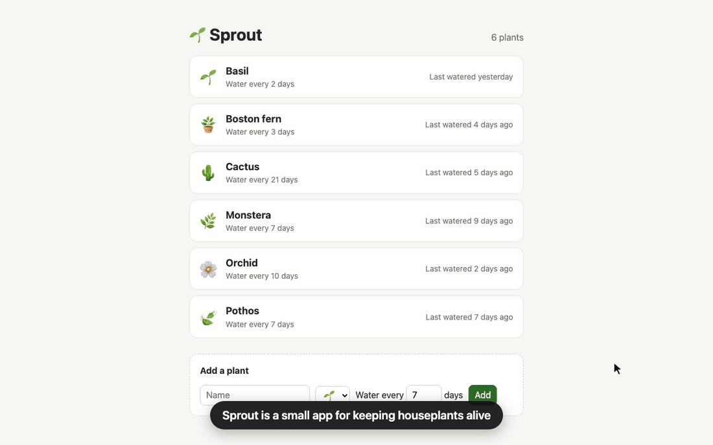
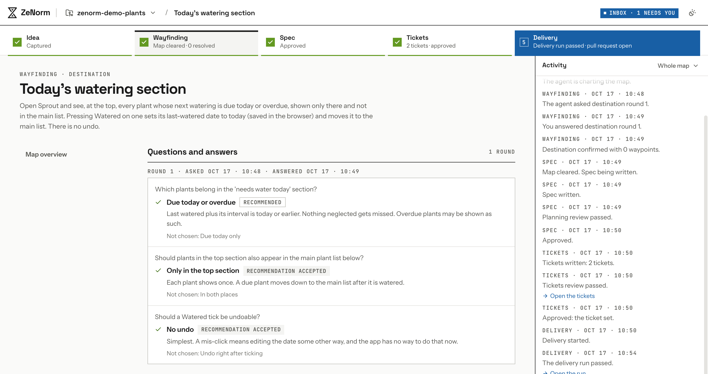
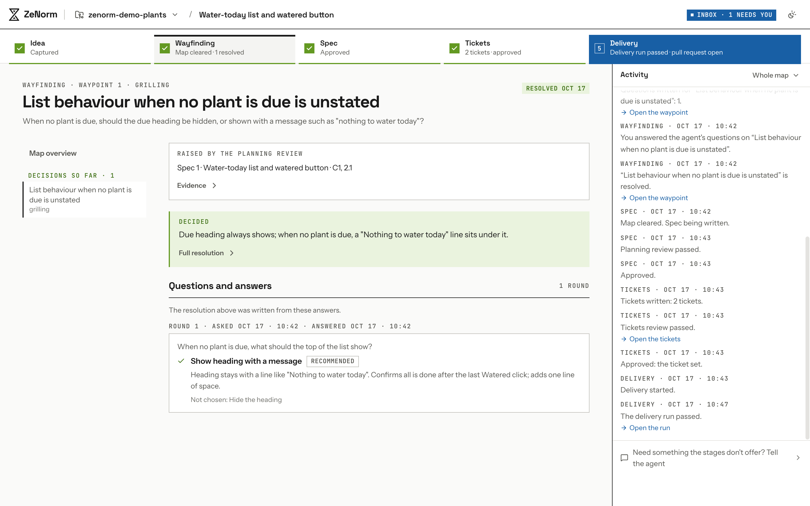

<div align="center">

<h1>
  <picture>
    <source media="(prefers-color-scheme: dark)" srcset=".github/assets/banner-dark.png" />
    
  </picture>
</h1>

**Plan anything. Build anything.**

ZeNorm is an open-source, spec-driven development workflow for Claude Code.

Bring any software idea, however rough. ZeNorm turns it into a clear plan, then builds it, keeping the two in step to the end.

[](LICENSE) [](https://docs.claude.com/en/docs/claude-code)

MIT licensed, and runs on your machine using [Claude Code](https://docs.claude.com/en/docs/claude-code).

[Website](https://zenorm.com/?ref=gh-readme) · [Setup](SETUP.md) · [Developing](DEVELOPING.md) · [Glossary](CONTEXT.md)

</div>

## Example: one change, start to finish

Sprout is a small demo app for keeping track of when to water your houseplants. Here, ZeNorm was asked to show which plants need water today. It asked three questions, wrote a plan, built the change and opened a pull request.

The agent's work is sped up. The timer shows how long each step really took.



## Why ZeNorm

Writing code is fast now. The hard part is deciding what to build, keeping that decision from drifting, and checking the result. A chat window gives you nothing to hold on to.

- **Decisions don't get lost in chat.** Every decision lands on a map, with the question, the options and who answered. The spec is written from the map, not from memory.
- **Big ideas don't fit in one prompt.** A map breaks the idea into waypoints, researches your code for each, and settles them one at a time.
- **Everything is reviewed.** A fresh agent reviews every spec, every ticket set and the finished work against what it was written from. Nothing ships until you say so.

## Install

You need macOS or Linux (on Windows, use WSL 2), Node.js 22.14 or later, git, and [Claude Code](https://docs.claude.com/en/docs/claude-code).

```sh
npm install -g @ze-norm/cli
zenorm init
zenorm run
```

Open [http://127.0.0.1:4310](http://127.0.0.1:4310), add a project, and start a map. If something's wrong, `zenorm doctor` tells you what. [SETUP.md](SETUP.md) covers configuration, signing in without a browser, and preparing a project for delivery.

If ZeNorm is useful to you, a star on GitHub helps others find it. Want ZeNorm in the cloud for your whole team? [ZeNorm Pro](https://zenorm.com/?ref=gh-readme#pro) is coming; join the waitlist.

## How it works

Point ZeNorm at a git repository on your machine (a **project**) and start a **map** for a change you have in mind. Each map moves through five stages:

| Stage          | What happens                                                                                                 |
| -------------- | ------------------------------------------------------------------------------------------------------------ |
| **Idea**       | Say what you want to change, in a sentence or a page.                                                        |
| **Wayfinding** | The agent charts a map of waypoints, researches the code, and asks you rounds of questions.                  |
| **Spec**       | Your decisions become a specification. An independent review checks it before you approve it.                |
| **Tickets**    | The spec becomes a ticket set, reviewed the same way.                                                        |
| **Delivery**   | One run builds every ticket on a branch, runs your checks, gets a separate review, and opens a pull request. |

The screenshots below also come from Sprout. Before any code is written, the agent asks about what the idea left open, each question with a recommended answer:



An independent review checks every spec before you approve it. On another map asking for much the same, it found that the spec never said what the list shows when no plant is due, and sent that back to you as a question:



A delivery run implements the tickets on one branch, reruns your required checks itself, has a fresh, read-only session review the result, and opens a pull request:


Everything ZeNorm plans and delivers happens in your project, on your machine. Its records stay on your machine too, in a local SQLite database.

## Extending ZeNorm

Plugins can add their own server routes, UI and delivery executor. The [example plugin](examples/plugin-example) exercises every extension point. The `zenorm` command runs without plugins; to compose one, run ZeNorm from a checkout ([DEVELOPING.md](DEVELOPING.md)).

## ZeNorm Pro

We're building ZeNorm Pro on top of this open-source workspace. ZeNorm itself stays MIT licensed. If you'd like to hear when there's something to try, join the waitlist at [zenorm.com](https://zenorm.com/?ref=gh-readme#pro).

## Learn more

- [SETUP.md](SETUP.md): requirements, installing, configuration and running ZeNorm
- [DEVELOPING.md](DEVELOPING.md): running from source, checks, tests and working on ZeNorm itself
- [CONTEXT.md](CONTEXT.md): the glossary (maps, waypoints, question rounds, planning reviews)
- [skills/](skills/README.md): the skills ZeNorm's agents follow

## Acknowledgements

ZeNorm is built on the workflow from Matt Pocock's [skills](https://github.com/mattpocock/skills). A map goes from an idea to tickets the way that workflow does, using its vocabulary (Wayfinder, maps, Grilling, Research, specifications and tickets), and many of the [skills](skills/README.md) ZeNorm's agents follow are adapted from that collection. ZeNorm turns that workflow into a workspace that runs on your machine.

## License

[MIT](LICENSE). ZeNorm includes skills adapted from Matt Pocock's [skills](https://github.com/mattpocock/skills) and components from [shadcn/ui](https://ui.shadcn.com), both under the MIT License; their notices are in [`THIRD_PARTY_NOTICES.md`](THIRD_PARTY_NOTICES.md).
